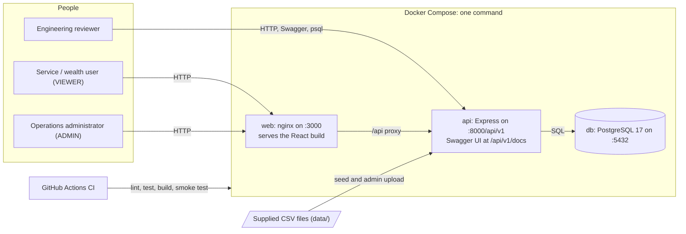
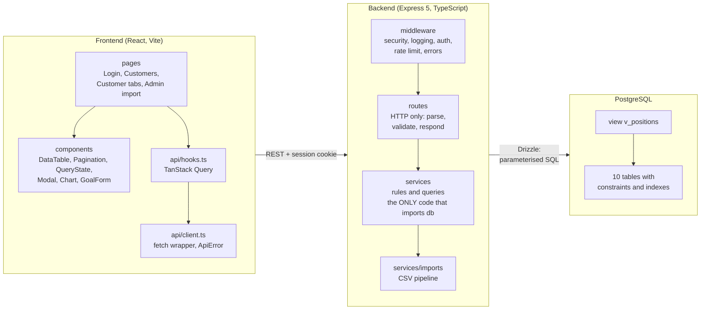
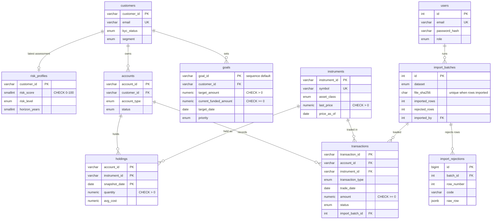
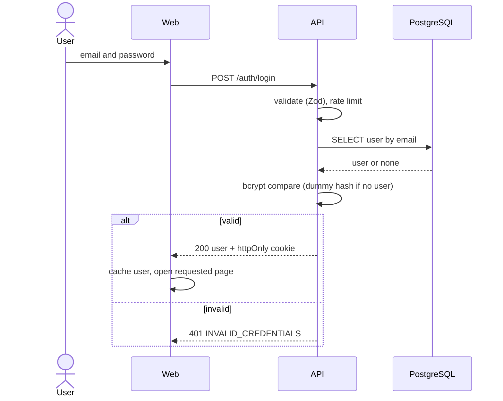
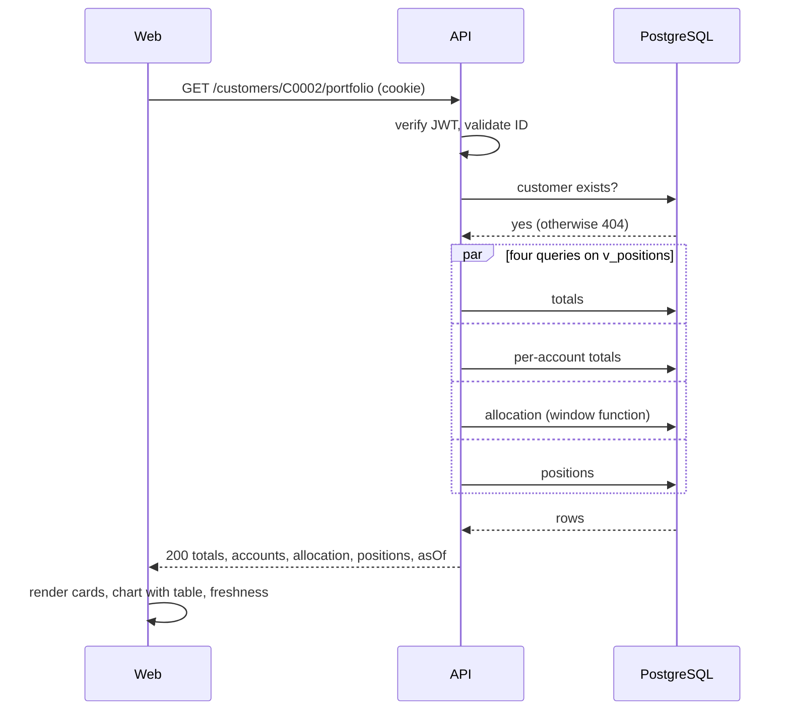
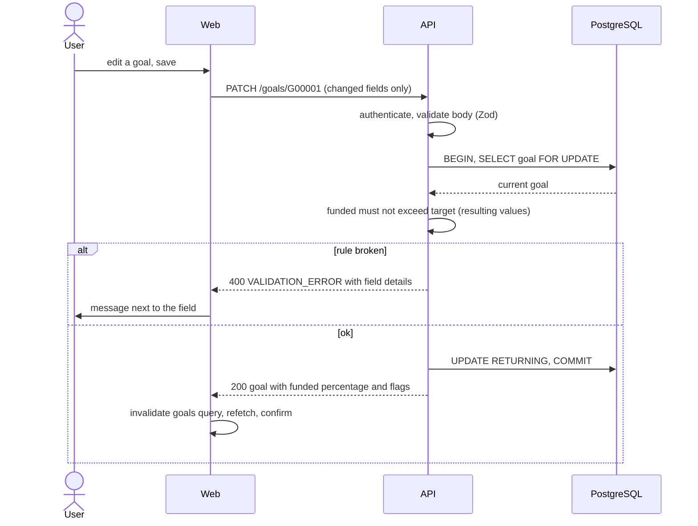
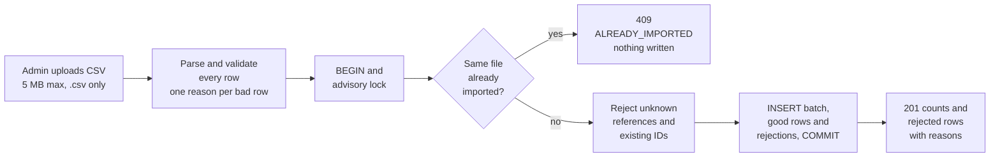
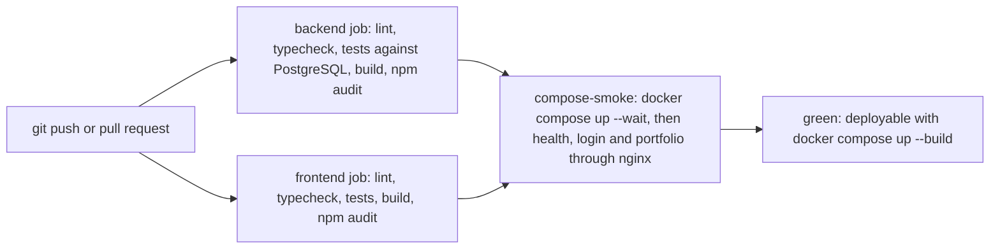
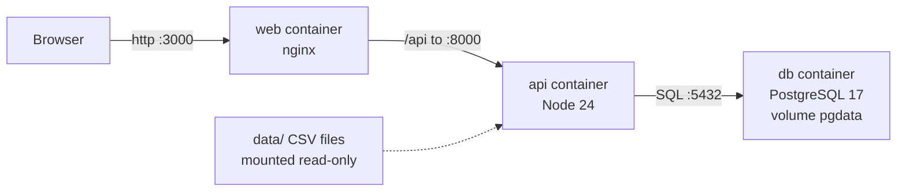
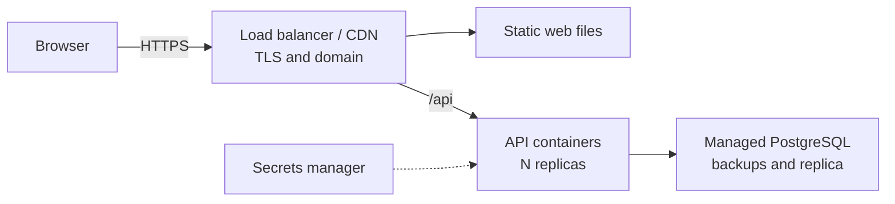

# FinPilot: Architecture and Design Report

*Investment Portfolio & Goal Monitoring Platform. Full-stack assignment submission. All data is synthetic.*

## 1. Executive overview

**Problem.** A service/wealth team needs one screen to understand a customer's consolidated investment position: who they are,
how risky they are, how much they hold and how it is allocated, what they traded recently, and how close they are to their
goals. Operations staff also need to load daily transaction files safely, see what was rejected and why, and never load a file twice.

**Scope delivered.** A login-protected web app with customer search and profile, a portfolio dashboard (value, gain/loss,
allocation chart, positions, data freshness), a server-filtered and paginated transaction ledger, goal create/edit with
overdue/inconsistent highlighting, and an administrator CSV import with row-level rejection reasons. Backed by PostgreSQL
with migrations, constraints, a view and indexes; a documented REST API (OpenAPI/Swagger); one-command local deployment;
CI/CD; and automated tests at every layer. Not built, by design: payments, order routing, investment advice.

**Stack.** React 19 + Vite + TypeScript + Tailwind (frontend); Node 24 + Express 5 + TypeScript + Zod (API); PostgreSQL 17 via
Drizzle ORM; Docker Compose (db, api, web/nginx); GitHub Actions.

**Major design decisions**

* **A single-page app plus a separate API**, not Next.js: an internal login-only tool has no SEO/SSR need, and the assignment
  asks for an independently documented API.
* **The database does the heavy lifting.** Constraints enforce integrity; one view (`v_positions`) does all portfolio maths;
  indexes serve the real query patterns. The browser never aggregates.
* **One import code path** (admin upload and seed): validate every row, reject bad rows with a reason code, never overwrite,
  never load the same file twice, and save everything in a single transaction.
* **One response envelope** for every endpoint, success or failure, so the client has a single code path.
* **Exact money**: `NUMERIC` in the database, strings in JSON, formatted only at the last step in the UI.

## 2. System context

*Figure 1. System context.*

External/platform dependencies: Docker (or Podman) to run the three containers, GitHub for CI, and nothing else. There are no
third-party runtime services. The browser talks to **one origin** (`:3000`); nginx forwards `/api` to the API, so the session
cookie is first-party and no CORS is involved in normal use.

## 3. Component architecture

*Figure 2. Component architecture and the data-access boundary.*

**Frontend.** Pages compose small reusable components. Server data is held by TanStack Query (caching, request de-duplication,
retry only for network/5xx errors); filters and page numbers live in the URL (shareable, survive refresh, validated on read);
the session comes from `/auth/me`. `QueryState` renders the four states of every request (loading, error with retry,
empty, data) so behaviour is identical on every screen. Charts have text and table alternatives. Recharts is loaded as its own
lazy chunk.

**Backend layers.**

| Layer | Responsibility | Rule |
|---|---|---|
| Middleware | Security headers, CORS, request id + logging, JSON/content-type guards, origin check (CSRF), authentication, role check, rate limiting, error translation | Cross-cutting concerns live in exactly one place |
| Routes | Parse and validate input (Zod), call one service, wrap the result in the envelope | No SQL, no business rules |
| Services | Business rules (goal flags, import rules) and all database access | **The only code that imports the database client**: the data-access boundary |
| Database | Integrity (constraints), aggregation (view), performance (indexes) | The last line of defence, independent of the application |

## 4. ERD and data model

*Figure 3. Entity-relationship diagram (key columns shown; `UK` = unique).*

**Keys and types.** Natural keys from the supplied files (`C0001`, `A00001`, `I0001`, `T0000001`, `G00001`) are the primary keys,
so imports are trivial and URLs are readable. Money is `NUMERIC(18,2)`, quantities `NUMERIC(18,4)`; dates are `DATE`.
Fifteen PostgreSQL enums reject unknown values. Goals created through the API continue the `G00178` series from a sequence.

**Constraints that carry business rules:** `amount >= 0`, `quantity >= 0` (transactions); `quantity > 0` (holdings);
`last_price > 0`; `risk_score BETWEEN 0 AND 100`; `target_amount > 0`; `current_funded_amount >= 0`; users' emails stored lower-case;
`imported + rejected = total` on every import batch. Foreign keys everywhere. The holdings primary key
`(account_id, instrument_id, snapshot_date)` is what stops duplicate snapshot rows from double-counting AUM.

**Indexes (query-driven, not "one per column").**

| Index | Serves |
|---|---|
| `transactions (account_id, trade_date DESC)` | The main list: one customer's accounts, newest first, one page. Output arrives pre-sorted, so no sort step. |
| `transactions (instrument_id)`, `holdings (instrument_id)` | Instrument filter; "top instruments by distinct holders" |
| `accounts (customer_id)`, `goals (customer_id)` | Customer-scoped lookups |
| unique `(dataset, file_sha256) WHERE imported_rows > 0` | Blocks loading the same file twice, but lets a file that imported nothing be retried |

Deliberately **no** index on customer name/city: with 120 rows a sequential scan is optimal and the planner would ignore it
(at scale: `pg_trgm`). `EXPLAIN (ANALYZE, BUFFERS)` evidence (`docs/evidence/explain-analyze.md`): with the index the list query is an
Index Scan with no sort, 3 buffers, 0.24 ms; without it, a sequential scan with sort, 51 buffers, 1.01 ms.

**View `v_positions`.** Every holding of the *current* snapshot (latest `snapshot_date`), joined to account and instrument, with
`market_value = round(qty × price, 2)`, `cost_value = round(qty × avg_cost, 2)` and `unrealised_pnl = market_value − cost_value`
(derived from the rounded figures, so the numbers on screen always reconcile to the cent). All portfolio endpoints and
reviewer queries read from it.

**Data-quality handling (summary; full table in DECISIONS.md).** The raw CSVs are never edited; the importer finds the problems.
Rejected and recorded: duplicate transaction ID, unknown instrument `I9999`, negative fee, future-dated trade, and 3 duplicate
holdings rows. Accepted on purpose and surfaced by queries: 1,069 transactions dated before their account's opening (23.5%, looks like
generator noise), holdings that do not reconcile to the ledger (the snapshot is the source of truth). Not flagged: goal names that
disagree with goal types (149 of 177, too noisy to be a signal).

## 5. API design

Base path **`/api/v1`** (the version is part of the URL). 13 endpoints, documented in OpenAPI (`backend/openapi.yaml`, Swagger UI at
`/api/v1/docs`, with examples for the portfolio and import endpoints).

| Method | Path | Role | Purpose |
|---|---|---|---|
| POST | `/auth/login`, `/auth/logout` | public | Sign in (sets the cookie) / sign out |
| GET | `/auth/me` | any | Current user (restores the session after a refresh) |
| GET | `/customers` | any | Search (ID, name, email, city) + paginate |
| GET | `/customers/{id}` | any | Profile + latest risk profile + accounts |
| GET | `/customers/{id}/portfolio` | any | Totals, per-account totals, allocation, positions, freshness |
| GET | `/customers/{id}/transactions` | any | Server-side filter, sort, pagination |
| GET / POST | `/customers/{id}/goals` | any | List with funded % and flags / create |
| PATCH | `/goals/{goalId}` | any | Edit selected fields |
| GET | `/instruments` | any | Filter dropdown data |
| POST | `/admin/imports/transactions` | ADMIN | Validate and import a CSV |
| GET | `/health` | public | Liveness + database readiness |

**Response envelope (every endpoint).** Success `{ "success": true, "data": …, "meta"?: { page, pageSize, total, totalPages } }`;
failure `{ "success": false, "error": { "code", "message", "details"?, "requestId" } }` with a matching HTTP status
(400, 401, 403, 404, 409, 413, 415, 429, 500, 503) and never a stack trace. `details` carries per-field messages for validation errors.

**Authentication and authorisation.** A signed JWT (HS256, 8 h) in an **httpOnly, SameSite=Lax cookie** (`Secure` when served over
HTTPS). Everything except login, logout, health and the docs requires a valid session; `/admin/*` additionally requires the ADMIN role.
Writes from a browser must come from an allow-listed `Origin` (CSRF defence).

**Validation.** Every input is validated at the edge with Zod: path IDs, query strings (strict integers, real calendar dates, enum
whitelists, sort-column whitelist), JSON bodies (unknown fields rejected, amounts normalised to exact decimal strings, cross-field
rules) and every CSV row. Database constraints back all of it up.

**Pagination, sorting, filtering.** `page`/`pageSize` (max 100) with `meta.total` and `meta.totalPages`; count and rows are two parallel
queries; ordering carries a unique tie-breaker so page boundaries are stable. A page past the end returns an empty list, not an error.

## 6. Workflow diagrams

*Figure 4. Login.*

*Figure 5. Customer portfolio read: a constant number of queries, no N+1, aggregation in the database.*

*Figure 6. Goal update (the row lock stops two simultaneous edits from jointly breaking a rule).*

*Figure 7. CSV import. Failure at any step before COMMIT leaves the database unchanged.*

*Figure 8. CI/CD. Any failing step fails the pipeline.*

## 7. Deployment topology

*Figure 9. Local topology: three containers, one command.*

*Figure 10. Mapping to production.*

| Service | Port | Notes |
|---|---|---|
| web | 3000 → 80 | nginx serves the build, falls back to `index.html`, proxies `/api` (forwards `X-Request-Id`), sets CSP and security headers; waits for a healthy API |
| api | 8000 | On start: apply migrations (one transaction) → seed (only if `SEED_ON_START=true`) → serve. Health check: `/api/v1/health`. Non-root user. |
| db | 5432 (loopback) | Named volume `pgdata`, `pg_isready` health check; the API starts only when it is healthy |

**Configuration and secrets.** `.env` (git-ignored) with a committed `.env.example`; the API validates its environment at start-up
(e.g. `JWT_SECRET` ≥ 32 chars) and refuses to run otherwise. No secret is committed or reaches the browser bundle. **Environments:**
local development (`npm run dev`, Vite proxy), local production-like (Compose), CI (service container + Compose smoke test).

**Mapping to production.** Static files to a CDN or container; API containers behind a load balancer that terminates TLS (ACM or
Let's Encrypt) with `COOKIE_SECURE=true` and `TRUST_PROXY` set; managed PostgreSQL (RDS / Cloud SQL) with automated backups,
point-in-time recovery and a replica; secrets from a secrets manager; least-privilege database roles (a migrator with DDL, an app role
with DML only); CI builds and pushes images, then deploys. **Connection pooling:** the API holds a `pg` pool of 10 (5 s connect timeout,
10 s statement timeout); PgBouncer in transaction mode when many replicas exist. **Migration rollback:** forward-only; a failed migration
rolls back entirely (one transaction) and stops the container; fix by a corrective migration, with a backup/snapshot taken first.

## 8. Security

| Concern | Control |
|---|---|
| Authentication | bcrypt password hashes; short-lived signed JWT in an httpOnly cookie (not readable by page scripts, so XSS cannot steal it); identical error and timing for unknown user vs wrong password; login limited to 10 attempts / 15 min / IP |
| Authorisation | Every non-public route requires a session; `/admin/*` requires ADMIN (checked before any upload is read); roles are re-validated against signed claims, algorithm pinned to HS256 |
| Input validation | Zod on path, query, body and every CSV row; 100 KB JSON limit; 5 MB upload limit, CSV only, 50,000 rows; unknown JSON fields rejected |
| SQL injection | The ORM binds every value as a parameter; the few raw `sql` fragments embed only bound parameters; LIKE wildcards in search are escaped; sort columns are whitelisted |
| XSS | React escapes output, no raw-HTML rendering; CSP on the API (helmet) and on the web container (nginx) |
| CSRF / CORS | SameSite=Lax cookie plus an `Origin` allow-list on every write; CORS restricted to the allow-list with credentials |
| Secrets | `.env` git-ignored, `.env.example` committed; config validated at start-up; nothing secret in the client bundle |
| Logs and PII | Structured logs; cookies and credentials redacted; request bodies, emails and phone numbers never logged; request id for correlation |
| Error handling | One error handler; unexpected errors become a generic 500 with a request id, the stack trace stays in the server log |
| Supply chain | `npm audit` on production dependencies in CI; lock files committed; minimal runtime image (non-root, no dev tools) |
| Data | All data is synthetic; PII-shaped fields (email, phone) are treated as sensitive anyway |

## 9. Reliability and operations

| Concern | Behaviour |
|---|---|
| Health checks | `/health` verifies the database (2 s timeout) and returns 200, or 503 in the standard envelope. Compose health checks gate start-up order (db → api → web). |
| Logging | pino JSON logs: one line per request (method, path, status, duration, request id), import outcomes with counts, full errors with stacks server-side only |
| Monitoring (next step) | Ship logs to a central store; add request/error/latency/pool metrics; alert on 5xx rate and `/health` |
| Timeouts | pg connect 5 s, statement 10 s, HTTP request 30 s; browser fetch 30 s with a clear message |
| Retries | The UI retries only GETs that fail with network or 5xx errors (twice); never 4xx. Writes are never retried automatically. |
| Failure behaviour | Database down: `/health` → 503, API → 503 `SERVICE_UNAVAILABLE`, UI shows "Connection/Server problem" with a Try-again button and a support reference. Idle-connection errors cannot crash the process. |
| Shutdown | SIGTERM stops accepting connections, drains in-flight requests, closes the pool, exits (forced after 10 s) |
| Imports | One transaction under an advisory lock: all or nothing, no race between concurrent uploads, no duplicate loads |
| Backups | Local: `pg_dump`. Production: managed backups with point-in-time recovery and periodic restore tests |
| Quality gates | 309 backend tests (unit, API, database; real PostgreSQL), 82 frontend tests, lint, typecheck and a Compose smoke test on every push |

## 10. Trade-offs and roadmap

**Intentionally omitted** (see DECISIONS.md): staging tables / `COPY` for imports, a TLS proxy locally, refresh tokens and token
revocation, a user-management UI, goal deletion and audit history, optimistic-concurrency tokens, Redux, cloud deployment.

**Expected scale limits.** Customer search is `ILIKE '%x%'` (fine for hundreds of customers; use a `pg_trgm` GIN index beyond ~100k).
Offset pagination degrades on very deep pages (use keyset pagination for the ledger). Imports run inside the request (≤ 50,000 rows;
use a job queue beyond that). Rate limiting is per instance (use a shared store with several replicas).

**Next production steps.** (1) Performance: trigram search index and keyset pagination. (2) Security: refresh tokens with a deny-list,
a CSRF token, separate migrator and application database roles, a secrets manager. (3) Reliability: managed PostgreSQL with tested
restores, background import jobs with progress, at least two API replicas, central logging/metrics/alerts.
